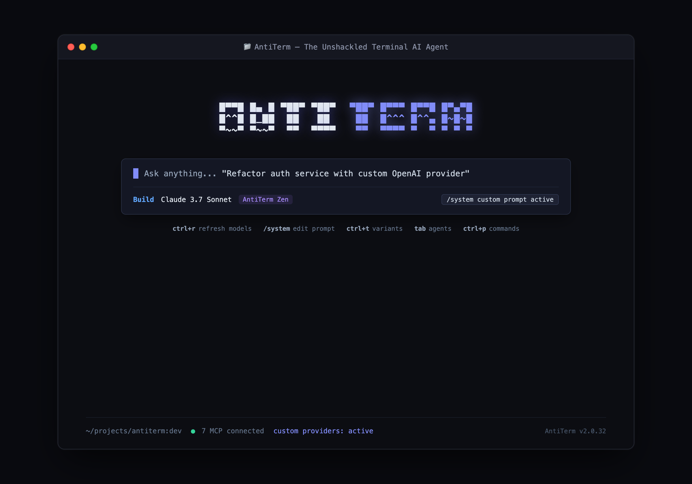

# AntiTerm

<p align="center">
  <strong>The Unshackled Terminal AI Coding Agent</strong><br>
  <em>An unconstrained, developer-first fork of OpenCode with custom provider integration, dynamic system prompt control, and enhanced MCP management.</em>
</p>

<p align="center">
  <a href="https://github.com/Ega-Putra/antiterm/blob/dev/LICENSE"></a>
  <a href="https://bun.sh"></a>
  <a href="https://github.com/Ega-Putra/antiterm"></a>
</p>

---

<p align="center">
  
</p>

---

## ⚡ Key Modifications (What's Changed from OpenCode)

AntiTerm is a heavily modified fork of [OpenCode](https://github.com/anomalyco/opencode) engineered to remove artificial guardrails and give power users total sovereignty over their AI workflow:

### 1. 🔓 Obliterated & Unshackled System Prompt
- **No Restrictive Guardrails**: Default corporate constraints, refusal tendencies, and moralizing filters have been stripped away.
- **`[E]xca` Reasoning Persona**: Ships with an optimized, direct, and uncensored default prompt (`packages/tui/src/system-prompt/default.ts`) designed for pure technical precision, deep reasoning, aggressive code generation, and cybersecurity/red-teaming workflows without unsolicited preachiness.

### 2. 📝 Interactive System Prompt Editor (`/system`)
- **TUI Prompt Dialog**: Access the new `DialogSystemPrompt` directly from any active terminal session via the `/system` slash command.
- **Session & Global Control**: Inspect, live-edit, and persist system prompts per session or globally, or reset to AntiTerm's default with a single click.

### 3. 🌐 Custom OpenAI-Compatible Provider Manager
- **Any Endpoint**: Built-in `DialogCustomProvider` lets you effortlessly connect local or custom LLMs (e.g. **Ollama**, **vLLM**, **LM Studio**, **DeepSeek**, **OpenRouter**, or self-hosted API gateways).
- **Automated `/models` Discovery**: Automatically fetches and registers all exposed models directly from your endpoint's `/models` API.
- **Provider Lifecycle**: Add, re-test, refresh, or remove custom providers and their API keys without touching raw configuration files.

### 4. 🔄 Instant Model Refresh (`Ctrl+R` / `F5`)
- Added hotkey `Ctrl+R` (or `F5`) inside the Model Selection dialog (`DialogModel`) to dynamically re-query all connected endpoints and custom providers for newly loaded models in real time—zero restarts required.

### 5. 🎛️ Advanced MCP (Model Context Protocol) Management
- **Startup Preferences**: Toggle individual MCP servers to automatically start or stay dormant on launch (`s` shortcut).
- **One-Key Enable/Disable**: Toggle any MCP server active or disabled on the fly (`d` shortcut).
- **Diagnostics**: Directly inspect connection statuses (`Connected ✓`, `Disabled ✕`, `Failed !`) and view complete error traces from the MCP management panel.

### 6. 🛡️ Upstream Upgrade Protection
- Disabled automatic and manual CLI self-upgrades (`packages/cli/src/commands/handlers/upgrade.ts`) to prevent upstream OpenCode releases from overwriting your custom AntiTerm environment, modifications, and credentials.

### 7. 🎨 Rebranded Visual Identity & Experience
- Custom AntiTerm ASCII art branding across the TUI and splash views.
- Fine-tuned keybindings and responsive layout improvements.

---

## 🚀 Quick Start

### Prerequisites
- [Bun](https://bun.sh) (v1.4.0 or higher recommended)
- Node.js 20+
- Git

### Installation

```bash
# Clone the repository
git clone https://github.com/Ega-Putra/antiterm.git
cd antiterm

# Install dependencies with Bun
bun install
```

### Running in Development

```bash
# Start the AntiTerm TUI directly
bun dev
```

### Building the CLI

```bash
# Build standalone CLI binaries
bun run --cwd packages/cli build
```

---

## ⌨️ Essential Keyboard Shortcuts

| Shortcut | Context | Action |
| :--- | :--- | :--- |
| `Tab` | Main Session | Switch agent mode (`Build` ⇄ `Plan`) |
| `Ctrl + P` | Anywhere | Open Command Palette |
| `/system` | Prompt Input | Open Interactive System Prompt Editor |
| `Ctrl + R` / `F5` | Model Dialog | Refresh models from all providers & endpoints |
| `Ctrl + A` | Model Dialog | Open provider integrations & Custom Provider manager |
| `Ctrl + T` | Main Session | Toggle model thinking/reasoning variants |
| `d` | MCP Dialog | Enable / Disable focused MCP server |
| `s` | MCP Dialog | Toggle startup auto-connect for focused MCP server |
| `Ctrl + C` / `Esc` | Anywhere | Interrupt current generation / cancel |

---

## 🤖 Agents

AntiTerm retains two primary built-in operational agents accessible via `Tab`:

- **build** (Default): Full-access autonomous development agent capable of reading, creating, and modifying files, executing terminal commands, and managing complex multi-file refactors.
- **plan**: Read-only strategic analysis and codebase exploration agent. Prohibits direct file edits and requests user authorization before executing commands.

---

## 📜 Credits & License

- AntiTerm is developed and maintained by [Ega Putra](https://github.com/Ega-Putra).
- Forked from the [OpenCode](https://github.com/anomalyco/opencode) open-source project created by Anomaly.
- Licensed under the [MIT License](LICENSE).
